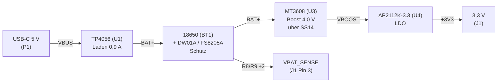

# 18650-3v3-supply

Stabile 3,3-V-Versorgung aus einer 18650-Li-Ion-Zelle, inklusive USB-Ladung und Zellschutz.
KiCad-Projekt (KiCad 10).

## Blockschaltbild

1. **Laden** – USB-C-Buchse (P1, 5 V) → TP4056 (U1), Ladestrom ca. 0,9 A (R1 = 1,2 kΩ an PROG,
   laut Datenblatt-Tabelle; für 1 A: R1 = 1,1 kΩ). CC1/CC2 je 5,1 kΩ (R10/R11) nach GND, damit
   USB-C-Netzteile 5 V liefern.
   LEDs: D1 rot = lädt, D2 grün = voll. TEMP liegt an GND (NTC-Überwachung deaktiviert).
2. **Akku + Schutz** – 18650-Zelle (BT1) zwischen BAT+ und BAT−, DW01A (U2) + Dual-MOSFET FS8205A (Q1).
   Abschaltung bei Überladung 4,3 V / Tiefentladung 2,4 V / Überstrom.
   Systemmasse GND = P− (hinter dem FS8205A).
3. **Boost** – MT3608 (U3) mit L1 = 22 µH (≥ 2 A) und Schottky D3 (SS14) auf ca. 4,0 V (Netz `VBOOST`):
   `Vout = 0,6 V × (1 + R6/R7) = 0,6 × (1 + 22k/3,9k) ≈ 3,98 V`.
   Für 5 V Ausgang: R7 = 3 kΩ. Bei vollem Akku (4,2 V) taktet der Boost nur noch wenig (4,2 V − U_F(SS14) < 3,98 V), der LDO regelt.
4. **LDO** – AP2112K-3.3 (U4) aus `VBOOST` → stabile 3,3 V an J1 (Eingangsbereich Akku 2,4 … 4,2 V, untere Grenze = DW01A-Abschaltung).

**VBAT_SENSE:** Akkuspannung / 2 über Teiler R8/R9 (2 × 100 kΩ) für einen ADC.
Bei ca. 1,5 V (= 3,0 V Akku) sollte der Verbraucher in den Schlafmodus gehen.

## Anschlüsse

| Ref | Funktion | Pins |
|-----|----------|------|
| P1  | USB_5V_IN | USB-C-Buchse (GCT USB4105), nur VBUS/GND/CC1/CC2 genutzt |
| J1  | OUT_3V3   | 3-polig JST-EH (1 = +3V3, 2 = GND, 3 = VBAT_SENSE) |

## Stückliste (Hauptbauteile)

| Ref | Wert |
|-----|------|
| U1 | TP4056 Lade-IC |
| U2 | DW01A Akkuschutz |
| Q1 | FS8205A Dual-N-MOSFET |
| U3 | MT3608 Boost-Wandler |
| U4 | AP2112K-3.3 LDO |
| BT1 | 18650 Li-Ion |
| L1 | 22 µH / ≥ 2 A |
| D1, D2 | LED rot / grün |
| D3 | SS14 Schottky |
| C1–C8 | 10 µF, 10 µF, 100 nF, 3 × 22 µF, 1 µF, 10 µF |
| R1–R11 | 1,2k, 1k, 1k, 100R, 1k, 22k, 3,9k, 100k, 100k, 5,1k, 5,1k |
| P1 | USB-C-Buchse GCT USB4105 |
| J1 | JST EH 3-polig |

## Dateien

| Datei | Inhalt |
|-------|--------|
| `Akku_3V3_Versorgung.kicad_pro` | KiCad-Projekt |
| `Akku_3V3_Versorgung.kicad_sch` | Schaltplan |
| `Akku_3V3_Versorgung.kicad_pcb` | Platine (noch leer / nicht geroutet) |
| `Akku3V3.kicad_sym` | Projektlokale Symbolbibliothek |
| `sym-lib-table` | Bindet `Akku3V3` über `${KIPRJMOD}` ein |

## Status

- [x] Schaltplan
- [ ] Footprints zuweisen
- [ ] PCB-Layout
- [ ] Fertigungsdaten (Gerber/Bohrdaten werden nicht eingecheckt, siehe `.gitignore`)

## Lizenz

Copyright © 2026 Eugen Vladimirski

Dieses Projekt steht unter der **CERN Open Hardware Licence Version 2 – Strongly Reciprocal**
(SPDX: `CERN-OHL-S-2.0`), siehe [`LICENSE`](LICENSE).
